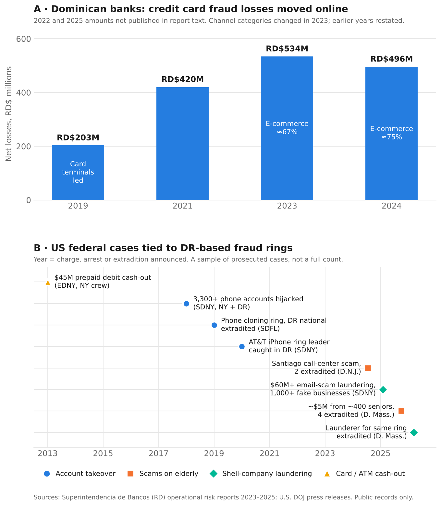

# Where fraud goes when the chip shuts the door

**A Dominican Republic case study in how fraud migrates, and what that means for fraud and AML tools in Latin America.**

Independent research project. Public records only. No individuals are profiled; names appear only as they do in public U.S. Department of Justice releases.

## The question

In the Dominican Republic, card fraud ("chipeo") is common enough to come up in popular music. Two things seemed worth testing:

1. Did EMV chip cards actually push Dominican card fraud online?
2. When DR-based rings go after money abroad, what does that fraud look like?

## What the data shows

**1. Domestic card fraud moved online.** The Superintendencia de Bancos (SB) publishes yearly operational risk reports. In 2019, in-person card terminals were the main source of credit card fraud losses. By 2023, e-commerce made up about two-thirds of those losses, and about 75% in 2024. Credit card fraud losses more than doubled over the same stretch, from RD$203M in 2019 to RD$534M in 2023. By 2025, digital channels (e-commerce plus online banking) made up about 53% of the banking system's net operational losses.

**2. Cross-border fraud is mostly not card fraud.** A sample of U.S. federal cases tied to DR-based rings points to three other patterns:

| Pattern | What happened | Examples |
|---|---|---|
| Account takeover | Stolen credentials used to hijack phone-carrier accounts and order devices | 3,300+ accounts and 1,200+ phones (SDNY); AT&T ring leader caught in the DR |
| Scams on elderly people | Call centers in the DR impersonate grandchildren or lawyers; U.S. "runners" collect cash | ~$5M from ~400 victims (D. Mass.); Santiago call centers (D.N.J.) |
| Shell-company laundering | Fake businesses open bank accounts to receive and move stolen funds | $60M+ ring, 1,000+ fake businesses (SDNY) |

**3. Enforcement is happening.** At least six extraditions from the DR in these cases alone, most since 2024.

## Why it matters for fraud and AML buyers

Chip cards solved the in-person card problem. The fraud that's left lives in places a card network can't see:

- **Account takeover:** device and behavior signals at login and checkout
- **Scam payments:** spotting a coached victim sending money
- **Mule and shell accounts:** catching fake businesses at onboarding (KYB) and odd fund flows afterward (AML transaction monitoring)

Mexico shows the same pattern at a much larger scale. Its financial consumer protection agency (CONDUSEF) logged about 8.1 million fraud complaints in 2024, roughly 71% of them cyber fraud.

## Limits

- SB reports count losses at **Dominican** institutions only. Fraud against U.S. cards or accounts shows up at U.S. institutions, which is why Panel B uses court cases instead.
- The SB changed its channel categories in 2023 and restated earlier card figures, so pre-2023 comparisons are approximate. Some years' amounts appear only in charts, not text, and are left out.
- Panel B is a sample of prosecuted cases, not a measure of total cross-border fraud.

## Data

- [`data/dr_fraud_sb.csv`](data/dr_fraud_sb.csv): every figure from the SB reports, with report and page references
- [`data/dr_crossborder_cases.csv`](data/dr_crossborder_cases.csv): U.S. federal cases with source links
- [`chart.py`](chart.py): rebuilds the chart from scratch

## Sources

- Superintendencia de Bancos, *Informe de Riesgo Operacional* [2023](https://www.sb.gob.do/media/lmvhgjkg/informe-de-riesgo-operacional-2023.pdf), [2024](https://sb.gob.do/media/r1fn1nhc/informe-de-riesgo-operacional-2024.pdf), [2025](https://sb.gob.do/media/b4yluafl/informe-de-riesgo-operacional-2025.pdf)
- U.S. DOJ press releases (linked per case in the CSV)
- CONDUSEF complaint data as reported in Mexican press

*Part of [enforcement-signals](../../README.md). The weekly tracker covers U.S. targets; this page looks at how fraud moves in Latin America.*
